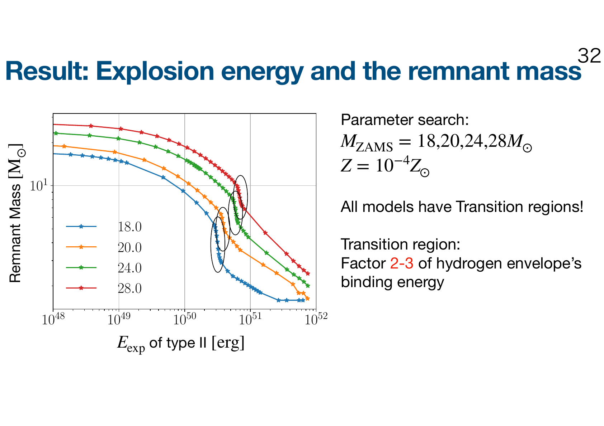
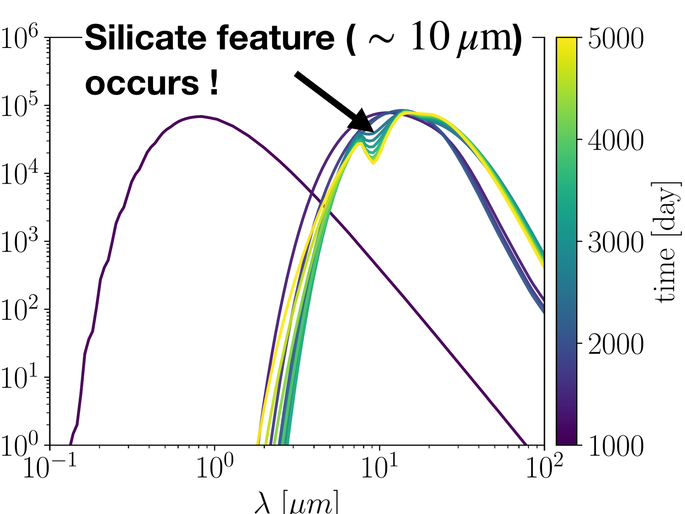
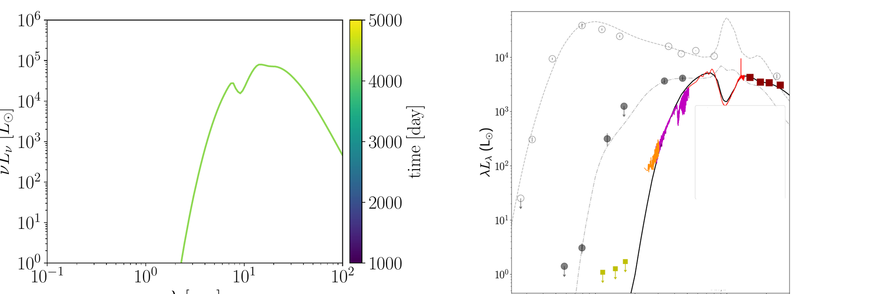

::: {.research-page}
<p class="research-kicker">SUPERNOVA THEORY · PROJECT 01</p>

## 超新星フォールバック

<p class="research-lead">爆発した星の物質は、すべて宇宙へ飛び去るとは限りません。中心へ戻る物質を追うことで、中性子星とブラックホールがどのような質量になるのかを探ります。</p>

大質量星の重力崩壊型超新星では、爆発で放出された物質の一部が中心天体へ再降着する「フォールバック」が、中性子星・ブラックホールの最終質量を左右します。本研究では、水素外層だけを取り除いたモデルとの比較を含む一次元流体計算により、外層がフォールバックをどう変えるかを調べました。その結果、爆発エネルギーが水素外層の重力結合エネルギーの約2〜3倍に達する境界で、逆向き衝撃波が中心へ戻るか外へ逃げるかが切り替わり、残骸質量が2太陽質量以上も急変することを発見しました。異なる初期質量の星でも、外層の結合エネルギーで規格化すると共通の関係に従います。これは、観測されるコンパクト天体の質量分布を理解し、種族合成計算へ取り込める簡潔な処方箋を与える結果です。

::: {.research-facts}
::: {.research-fact}
<span class="research-fact__label">問い</span>

水素外層はフォールバック量をどのように変えるのか
:::

::: {.research-fact}
<span class="research-fact__label">方法</span>

水素外層の有無だけが異なる親星の一次元流体計算
:::

::: {.research-fact}
<span class="research-fact__label">主要結果</span>

外層の結合エネルギーを基準にした普遍的な質量遷移
:::
:::

### 水素外層が逆向き衝撃波を生む

::: {.research-figure}
```{=html}

```

<p class="research-figure__caption"><span>01</span> 水素外層に入る前は、水素あり・なしのモデルで衝撃波の進み方はほぼ同じです。外層へ入ると逆向き衝撃波が生まれ、内向きの流れを作ります。</p>
:::

### 爆発の強さが残骸質量を切り替える

::: {.research-figure}
```{=html}

```

<p class="research-figure__caption"><span>02</span> 初期質量18〜28太陽質量のすべてのモデルに、残骸質量が急変する遷移領域が現れます。その境界は、水素外層の重力結合エネルギーの約2〜3倍で整理できます。</p>
:::

::: {.research-takeaway}
#### この研究が示すこと

水素外層は単なる「星の外側」ではなく、逆向き衝撃波を介して中心のコンパクト天体の質量を大きく変えます。外層の結合エネルギーを測れば、フォールバック後の残骸質量を予測する手がかりになります。
:::

<p class="research-source">Figures adapted from seminar slides based on <cite>“Impacts of hydrogen envelope on supernova fallback and the resulting compact remnant masses”</cite>.</p>
:::

<hr class="research-project-divider">

::: {.research-page .research-page--dust}
<p class="research-kicker">FAILED SUPERNOVAE · PROJECT 02</p>

## 失敗型超新星：ダストで探るブラックホール形成

<p class="research-lead">星が消えたあとに残る赤外線の光から、ブラックホール誕生の痕跡を読み解きます。</p>

大質量星の中には、明るい爆発を起こさず、物質の大部分が落下してブラックホールを残す「失敗型超新星」があると考えられています。この暗い現象を捉える鍵が、わずかに放出された物質中で形成されるダストの赤外線放射です。本研究では、放出物質の熱進化、ダストの核生成・成長、放射輸送を時間依存で接続しました。その結果、爆発後約1000日からダストが効率的に形成され、中心光を中間赤外線へ再放射し、約10 µmにシリケートの吸収構造を作ることが分かりました。約4000日後のモデルスペクトルは候補天体M31-2014-DS1のJWST観測と概ね一致します。長期赤外線観測と中間赤外線分光が、可視光では見えにくいブラックホール形成を探る有力な手段になることを示す研究です。

::: {.research-facts}
::: {.research-fact}
<span class="research-fact__label">問い</span>

暗いブラックホール形成を赤外線残光からどう見つけるか
:::

::: {.research-fact}
<span class="research-fact__label">方法</span>

熱進化、ダスト形成、光学特性、放射輸送の時間依存計算
:::

::: {.research-fact}
<span class="research-fact__label">主要結果</span>

約10 µmのシリケート構造と長期間続く赤外線残光
:::
:::

### ダストが中心光を赤外線へ変換する

::: {.research-figure}
```{=html}

```

<p class="research-figure__caption"><span>01</span> 低エネルギーで放出された物質はゆっくり膨張し、高密度のまま冷えるため、爆発後約1000日からダストが効率的に形成されます。中心光は中間赤外線へ再処理され、約10 µmにシリケート特有の構造が現れます。</p>
:::

### 候補天体のJWSTスペクトルを再現する

::: {.research-figure}
```{=html}

```

<p class="research-figure__caption"><span>02</span> 爆発後約4000日のモデル（左）は、M31-2014-DS1のJWST観測（右）で得られた赤外線光度、連続成分、10 µm付近の構造を概ね再現します。</p>
:::

::: {.research-takeaway}
#### この研究が示すこと

赤外線が明るくなる時刻は、ブラックホールが生まれた瞬間ではなく、放出物質がダスト形成温度まで冷えた時刻で決まります。可視光の減光、赤外線SED、ダスト組成に由来する吸収構造を組み合わせることで、崩壊時刻と放出物質の性質を制限できます。
:::

<p class="research-source">Figures from <cite>「失敗型超新星」</cite>, 2026年度 第56回 天文・天体物理若手夏の学校.</p>
:::
