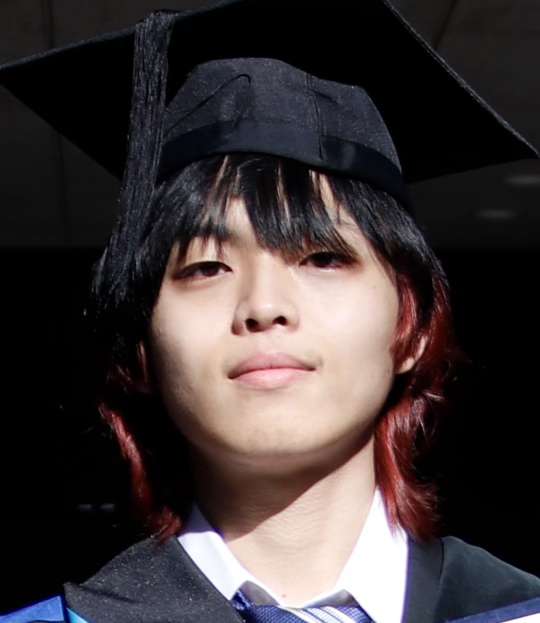

::: {.home-page .column-screen}
::: {.home-hero}
::: {.home-hero__inner}

ASTROPHYSICS · COMPUTATIONAL SCIENCE

# Website of Kengo Shinoda

Kengo Shinoda

Doctoral Student in Astronomy

:::
:::

::: {.home-profile}
::: {.home-profile__inner}
{.profile-photo alt="Portrait of Kengo Shinoda"}

::: {.profile-introduction}

WELCOME

## Welcome

I am a doctoral student in the Department of Astronomy, Graduate School of Science, The University of Tokyo.

For my research activities, please see [Publications](publications.qmd) and [Presentations](presentations.qmd).

::: {.profile-actions}
[Profile](about.qmd){.profile-action .profile-action--secondary}
:::
:::
:::
:::

:::
