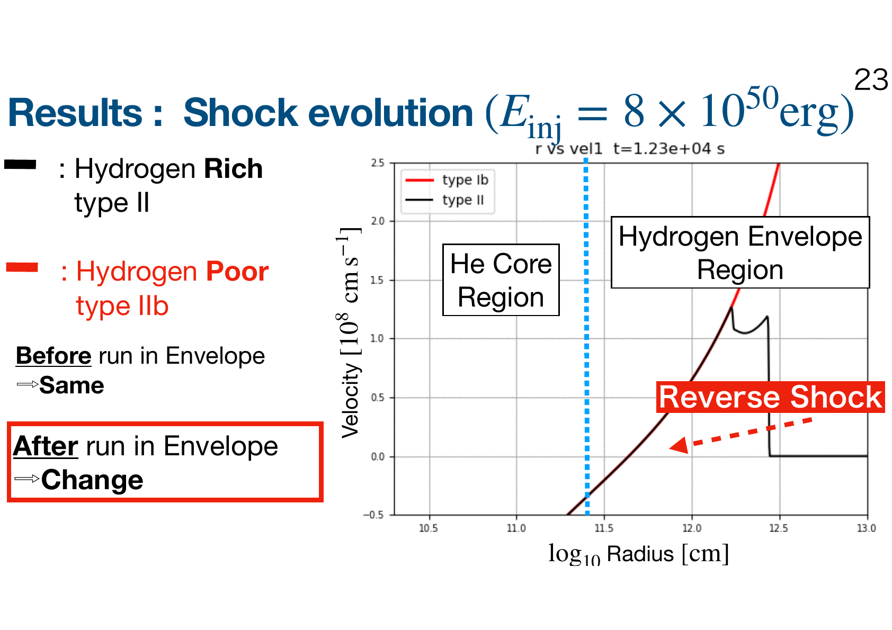

[日本語へ戻る](../research.qmd)

::: {.research-page}
<p class="research-kicker">SUPERNOVA THEORY · PROJECT 01</p>

## Supernova fallback

<p class="research-lead">Not all material launched by an exploding star escapes into space. By following the matter that returns to the centre, I study how neutron stars and black holes acquire their final masses.</p>

In a core-collapse supernova, part of the ejecta can fall back onto the newly formed compact object. This fallback helps determine the final mass of a neutron star or black hole. Using one-dimensional hydrodynamic simulations, I compared progenitors that differ only in whether they retain their hydrogen envelope. The calculations reveal a sharp transition: when the explosion energy is approximately two to three times the binding energy of the hydrogen envelope, the reverse shock switches between returning to the centre and escaping outwards. This changes the remnant mass by more than two solar masses. Progenitors with different initial masses follow a common relation once the explosion energy is normalized by the envelope binding energy, providing a compact prescription for population-synthesis calculations.

::: {.research-facts}
::: {.research-fact}
<span class="research-fact__label">Question</span>

How does the hydrogen envelope alter supernova fallback?
:::

::: {.research-fact}
<span class="research-fact__label">Method</span>

One-dimensional models differing only in the hydrogen envelope
:::

::: {.research-fact}
<span class="research-fact__label">Key result</span>

A universal mass transition set by the envelope binding energy
:::
:::

### The hydrogen envelope launches a reverse shock

::: {.research-figure}
```{=html}

```

<p class="research-figure__caption"><span>01</span> Before entering the hydrogen envelope, the shocks evolve almost identically. Inside the envelope, a reverse shock develops and drives matter back towards the centre.</p>
:::

### Explosion strength selects the remnant mass

::: {.research-figure}
```{=html}

```

<p class="research-figure__caption"><span>02</span> Every progenitor from 18 to 28 solar masses exhibits a sharp transition in remnant mass. Its location is set by roughly two to three times the hydrogen-envelope binding energy.</p>
:::

::: {.research-takeaway}
#### Why this matters

The hydrogen envelope is not merely the outermost part of the star. Through the reverse shock, it can substantially alter the compact object left at the centre. Its binding energy therefore offers a practical way to predict the remnant mass after fallback.
:::

<p class="research-source">Figures adapted from seminar slides based on <cite>“Impacts of hydrogen envelope on supernova fallback and the resulting compact remnant masses”</cite>.</p>
:::
